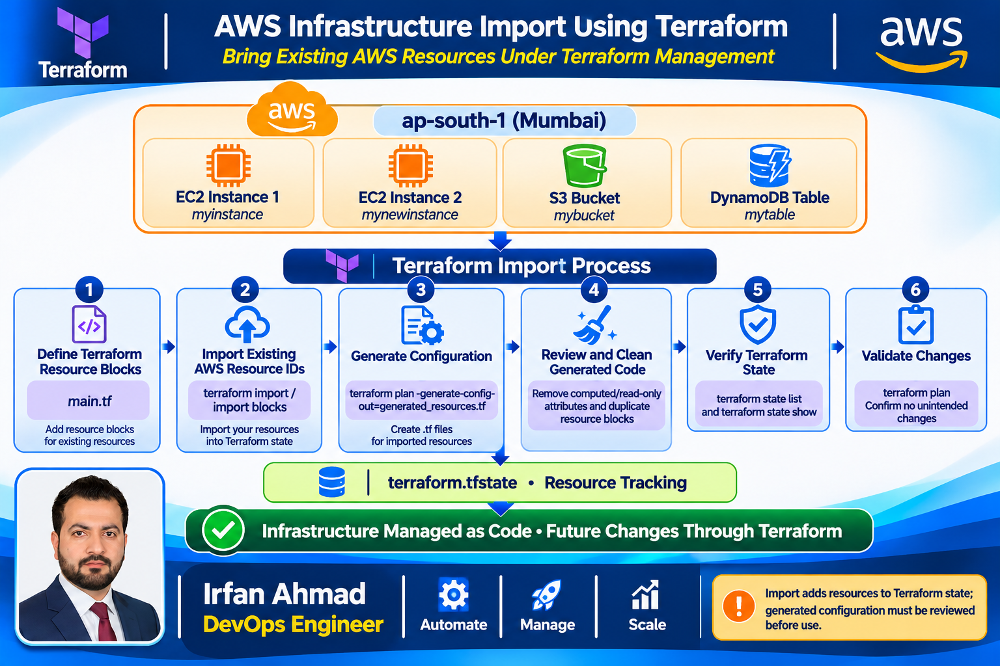
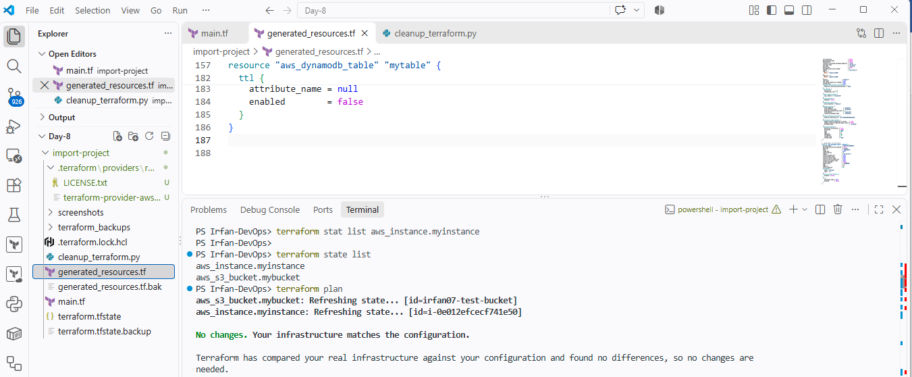

# Importing Existing AWS Infrastructure into Terraform



## 1. Project Overview

This project demonstrates how to import existing AWS infrastructure into Terraform and manage it using Infrastructure as Code (IaC).

The project was performed step by step to understand how Terraform can manage resources that already exist in AWS, as well as newly created resources, without recreating the existing infrastructure.

Instead of creating all resources through Terraform, I initially created some resources directly in AWS and then imported them into Terraform.

During the project, I gradually expanded the AWS infrastructure by adding new resources directly through the AWS Management Console and importing them into the existing Terraform project.

### Project Objectives

- Import existing AWS resources into Terraform.

- Understand Terraform import blocks.

- Generate Terraform resource configurations automatically.

- Manage multiple AWS resources within a single Terraform project.

- Add new AWS resources directly through the AWS Console and import them into Terraform.

- Understand Terraform state management.

- Verify infrastructure consistency using `terraform plan`.

## 2. Technologies and Tools Used

| Technology   | Purpose                       |

| ------------ | ----------------------------- |

| AWS          | Cloud infrastructure          |

| Terraform    | Infrastructure as Code        |

| AWS EC2      | Virtual machine instances     |

| AWS S3       | Object storage                |

| AWS DynamoDB | NoSQL database                |

| AWS CLI      | AWS authentication and access |

| Git          | Version control               |

| GitHub       | Source code management        |

| PowerShell   | Command-line execution        |

****AWS Region:**** `ap-south-1` (Mumbai)

## 3. Initial Project Architecture

Initially, I had the following resources already available in my AWS account:

1. One EC2 instance.

2. One S3 bucket.

The objective was to import these existing resources into Terraform and manage them through a single Terraform configuration.

### Initial AWS Resources

| AWS Service  | Terraform Resource        |

| ------------ | ------------------------- |

| EC2 Instance | `aws_instance.myinstance` |

| S3 Bucket    | `aws_s3_bucket.mybucket`  |

## 4. Project Folder Structure

The Terraform project was organized as follows:

```text

Irfan-DevOps/

│

├── .gitignore

├── .terraform.lock.hcl

├── cleanup_terraform.py

├── generated_resources.tf

├── generated_resources.tf.bak

├── main.tf

├── README.md

├── terraform.tfstate

├── terraform.tfstate.backup

│

├── .terraform/

│   └── providers/

│       └── registry.terraform.io/

│           └── hashicorp/

│               └── aws/

│                   └── 6.73.0/

│                       └── windows_amd64/

│                           ├── LICENSE.txt

│                           └── terraform-provider-aws_v6.73.0_x5.exe

│

├── screenshots/

│   ├── AWS-Infrastructure-Import-with-Terraform.png

│   ├── dynamo-db-table-created-and-imported.png

│   ├── EC2-S3-initial-resource-import-1.png

│   ├── EC2-S3-on-AWS.png

│   ├── EC2-S3-Statelist-1.png

│   ├── final-statelist-validate-plan.png

│   ├── imported-resources-destroyed-and-statelist.png

│   └── New-EC2-added-and-imported.png

│

└── terraform_backups/

    └── generated_resources_backup_20261118_093513.tf

```

### File Description

****main.tf****

Contains the AWS provider configuration and Terraform import blocks used during the import process.

****generated_resources.tf****

Contains the generated Terraform resource configurations for all imported AWS resources.

****temp_generated.tf****

A temporary file used to generate Terraform configurations for newly added AWS resources. After reviewing the generated configuration, the required resource blocks were moved into `generated_resources.tf`.

****terraform.tfstate****

Terraform state file containing the mapping between Terraform resource addresses and actual AWS resources. This file is maintained locally and should not be committed to a public GitHub repository.

## 5. Step 1 – Configure Terraform AWS Provider

First, I configured the AWS provider in `main.tf`.

```hcl

provider "aws" {

  region = "ap-south-1"

}

```

AWS credentials were configured separately using the AWS CLI.

Verify AWS authentication:

```powershell

aws sts get-caller-identity

```

Initialize Terraform:

```powershell

terraform init

```

## 6. Step 2 – Import the Initially Existing EC2 Instance

The first existing EC2 instance was already running in AWS.

Instead of creating another EC2 instance through Terraform, I imported the existing instance into Terraform.

### Import Block

Added the following import block in `main.tf`:

```hcl

import {

  to = aws_instance.myinstance

  id = "YOUR_EC2_INSTANCE_ID"

}

```

### Generate Terraform Configuration

Executed:

```powershell

terraform plan -generate-config-out="generated_resources.tf"

```

Terraform generated the resource configuration based on the existing EC2 instance.

The generated configuration was reviewed and retained in the project.


## 7. Step 3 – Import the Existing S3 Bucket

Next, I imported an existing S3 bucket into the same Terraform project.

### Import Block

```hcl

import {

  to = aws_s3_bucket.mybucket

  id = "irfan07-test-bucket"

}

```

The import block was added to `main.tf`.

The S3 bucket was imported using Terraform's generated configuration workflow.

The generated resource configuration was added to `generated_resources.tf`.

At this stage, Terraform was managing:

- One EC2 instance.

- One S3 bucket.




## 8. Step 4 – Add a New EC2 Instance Directly in AWS

After successfully importing the initial EC2 instance and S3 bucket, I created another EC2 instance directly through the AWS Management Console.

This was done to understand how Terraform can import resources that are added to AWS after the Terraform project has already been created.

The newly created EC2 instance was:

- Name: `webserver008`

- Instance type: `t3.micro`

- Availability Zone: `ap-south-1b`

- Region: `ap-south-1`

### Import Block

I added another import block in `main.tf`:

```hcl

import {

  to = aws_instance.mynewinstance

  id = "i-0adb5d24d0bddecde"

}

```

Notice that I used a new Terraform resource address:

`aws_instance.mynewinstance`

This is important because every resource must have a unique Terraform address.

### Generate Configuration for the New EC2 Instance

Since `generated_resources.tf` already existed, I did not generate the new configuration directly into that file.

Terraform requires the configuration generation output file to be a new file that does not already exist.

Therefore, I used:

```powershell

terraform plan -generate-config-out="temp_generated.tf"

```

Terraform generated the configuration for the newly added EC2 instance in `temp_generated.tf`.

### Review and Move the Generated Configuration

After reviewing the generated configuration, I copied the complete resource block for:

```hcl

resource "aws_instance" "mynewinstance" {

  # Generated EC2 configuration

}

```

I moved this resource block into the existing `generated_resources.tf` file.

The temporary file was removed after confirming that the required configuration had been copied successfully.

This approach allowed me to maintain all resource configurations in one file instead of creating separate Terraform files for every imported resource.


## 9. Step 5 – Add a DynamoDB Table Directly in AWS

After successfully importing the second EC2 instance, I added an Amazon DynamoDB table directly through the AWS Management Console.

The objective was to import this newly created DynamoDB table into the same existing Terraform project.

### DynamoDB Import Block

I added the following import block in `main.tf`:

```hcl

import {

  to = aws_dynamodb_table.mytable

  id = "mydbtable"

}

```

Here:

- `aws_dynamodb_table` is the Terraform resource type.

- `mytable` is the Terraform resource name.

- `mydbtable` is the existing DynamoDB table name in AWS.

### Generate DynamoDB Configuration

I generated the Terraform resource configuration using:

```powershell

terraform plan -generate-config-out="temp_generated.tf"

```

Terraform refreshed the existing resources and prepared the DynamoDB table for import.

### Resolve Point-in-Time Recovery Configuration

During configuration generation, Terraform reported the following error:

```text

expected point_in_time_recovery.0.recovery_period_in_days

to be in the range (1 - 35), got 0

```

The generated configuration contained an invalid recovery period value.

After reviewing the existing DynamoDB table's Point-in-Time Recovery configuration, I removed the invalid `recovery_period_in_days = 0` argument while retaining the appropriate setting for the table.

The corrected configuration was:

```hcl

point_in_time_recovery {

  enabled = false

}

```

This setting should reflect the actual AWS table configuration.

### Review the Terraform Plan

After correcting the configuration, I executed:

```powershell

terraform plan

```

Terraform displayed:

```text

Plan: 1 to import, 0 to add, 0 to change, 0 to destroy.

```

This confirmed that Terraform was going to import the existing DynamoDB table without creating, modifying, or destroying infrastructure.

I approved the import by entering:

```text

yes

```

The DynamoDB table was successfully imported.


### Move Generated Configuration

As with the second EC2 instance, I reviewed the generated DynamoDB configuration in `temp_generated.tf` and moved the complete resource block into `generated_resources.tf`.

After confirming that the resource configuration was safely copied, I removed the temporary file.

## 10. Step 6 – Final Terraform Configuration

All imported resource configurations were maintained in:

`generated_resources.tf`

The Terraform project now manages the following resources:

| No. | AWS Service    | Terraform Resource Address   |

| --- | -------------- | ---------------------------- |

| 1   | EC2 Instance   | `aws_instance.myinstance`    |

| 2   | S3 Bucket      | `aws_s3_bucket.mybucket`     |

| 3   | EC2 Instance   | `aws_instance.mynewinstance` |

| 4   | DynamoDB Table | `aws_dynamodb_table.mytable` |

## 11. Step 7 – Format and Validate Terraform Configuration

After importing all resources and moving their generated configurations into `generated_resources.tf`, I formatted the Terraform files.

```powershell

terraform fmt

```

Next, I validated the configuration:

```powershell

terraform validate

```

Expected output:

```text

Success! The configuration is valid.

```

This confirmed that the Terraform configuration was syntactically valid.

## 12. Step 8 – Verify Imported Resources in Terraform State

To verify that all resources were successfully imported, I executed:

```powershell

terraform state list

```

The output was:

```text

aws_dynamodb_table.mytable

aws_instance.myinstance

aws_instance.mynewinstance

aws_s3_bucket.mybucket

```

This confirmed that all four AWS resources were present in Terraform state.

### Inspect Individual Resources

To view the complete details of an imported EC2 instance:

```powershell

terraform state show aws_instance.mynewinstance

```

To view the imported S3 bucket:

```powershell

terraform state show aws_s3_bucket.mybucket

```

To view the imported DynamoDB table:

```powershell

terraform state show aws_dynamodb_table.mytable

```

## 13. Step 9 – Final Terraform Plan and Infrastructure Verification

Finally, I executed:

```powershell

terraform plan

```

Terraform refreshed all four AWS resources and compared the actual AWS infrastructure against the Terraform configuration.

### Final Output

```text

aws_s3_bucket.mybucket: Refreshing state...

aws_dynamodb_table.mytable: Refreshing state...

aws_instance.mynewinstance: Refreshing state...

aws_instance.myinstance: Refreshing state...

No changes. Your infrastructure matches the configuration.

```

### Final Plan Result

```text

No changes. Your infrastructure matches the configuration.

Terraform has compared your real infrastructure

against your configuration and found no differences,

so no changes are needed.

```

This confirmed that all four imported resources were successfully managed by Terraform and that the configuration matched the actual AWS infrastructure.

No additional `terraform apply` was required because the final plan showed no infrastructure changes.


## 14. Important Terraform Concepts Learned

Through this hands-on project, I gained practical experience with:

1. Importing existing AWS resources into Terraform.

2. Using Terraform import blocks.

3. Generating Terraform configurations using `-generate-config-out`.

4. Understanding why Terraform requires a new output file during configuration generation.

5. Managing multiple AWS resources in a single Terraform project.

6. Understanding Terraform resource addresses.

7. Managing Terraform state using `terraform state list` and `terraform state show`.

8. Resolving configuration issues during resource import.

9. Formatting and validating Terraform configurations.

10. Verifying infrastructure consistency using `terraform plan`.

## 15. Best Practices Followed

- Reviewed generated Terraform configurations before using them.

- Used unique Terraform resource addresses for each imported resource.

- Kept generated resource configurations organized in `generated_resources.tf`.

- Used `temp_generated.tf` for generating configurations for newly added AWS resources.

- Moved reviewed resource blocks from the temporary file into the main generated resource file.

- Validated the Terraform configuration after modifications.

- Reviewed the Terraform plan before approving imports.

- Verified the final Terraform state.

- Avoided unnecessary changes to existing AWS infrastructure.

- Kept Terraform state files and sensitive credentials out of the public GitHub repository.

## 16. Final Project Outcome

<details> \<summary>Final AWS infrastructure managed through Terraform\</summary>

| AWS Service     | Imported Resources | Status                   |

| --------------- | -----------------: | ------------------------ |

| Amazon EC2      |                  2 | Successfully imported    |

| Amazon S3       |                  1 | Successfully imported    |

| Amazon DynamoDB |                  1 | Successfully imported    |

| ****Total****       |              ****4**** | ****Successfully managed**** |

</details>

****Final Terraform Result:****

```text

No changes. Your infrastructure matches the configuration.

```

This project demonstrates a practical real-world Terraform workflow where existing AWS infrastructure was imported, new AWS resources were added over time, and all resources were brought under Terraform management without recreating the existing infrastructure.

## Additional Screenshot – Resource Cleanup

The following screenshot is separate cleanup evidence showing the imported resources being destroyed and the resulting Terraform state list. It is not the final managed-state verification described in Steps 8–9 above.


## Author

****Irfan Ahmad****  

DevOps Engineer

- **Project Repository:** [AWS Terraform Resource Import](https://github.com/Irfan-devops1/terraform-aws-resource-import-project)

- **GitHub Profile:** [Irfan-devops1](https://github.com/Irfan-devops1)
