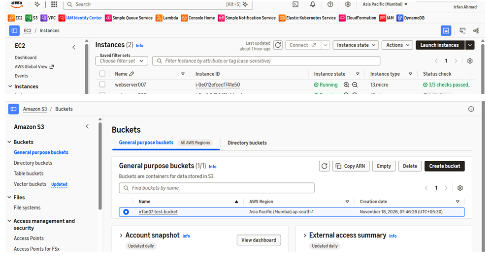
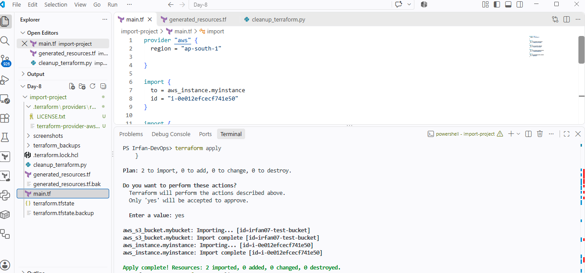
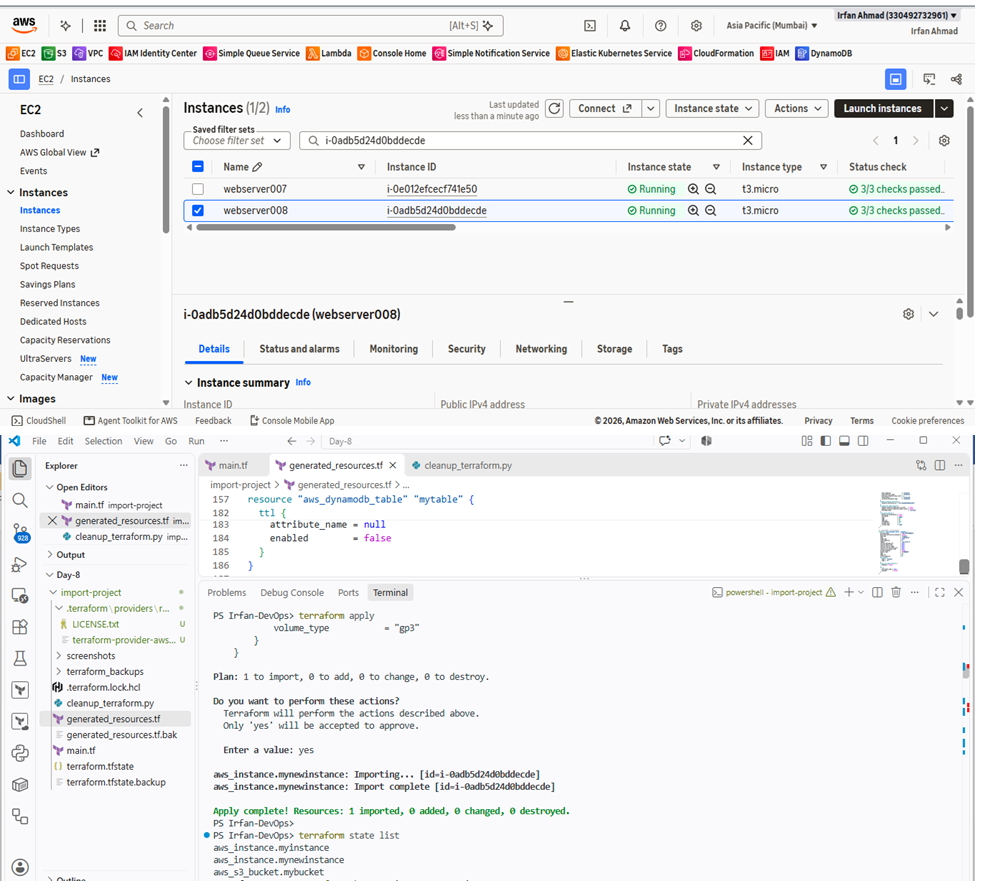
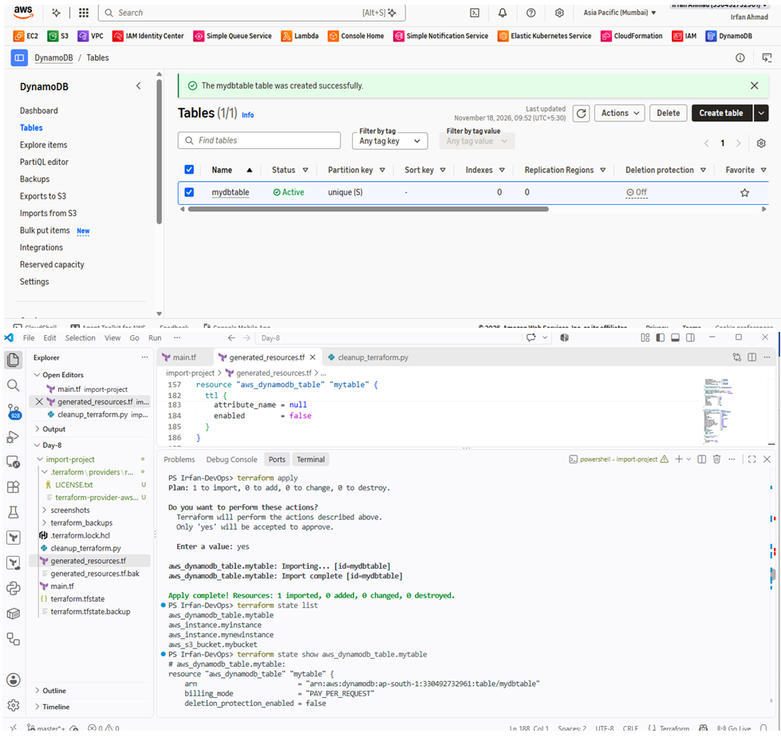
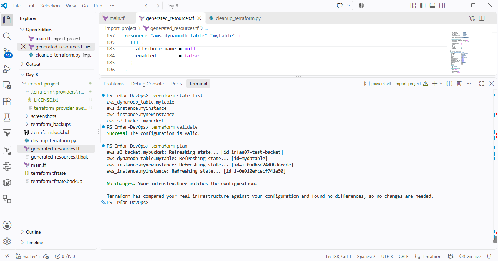
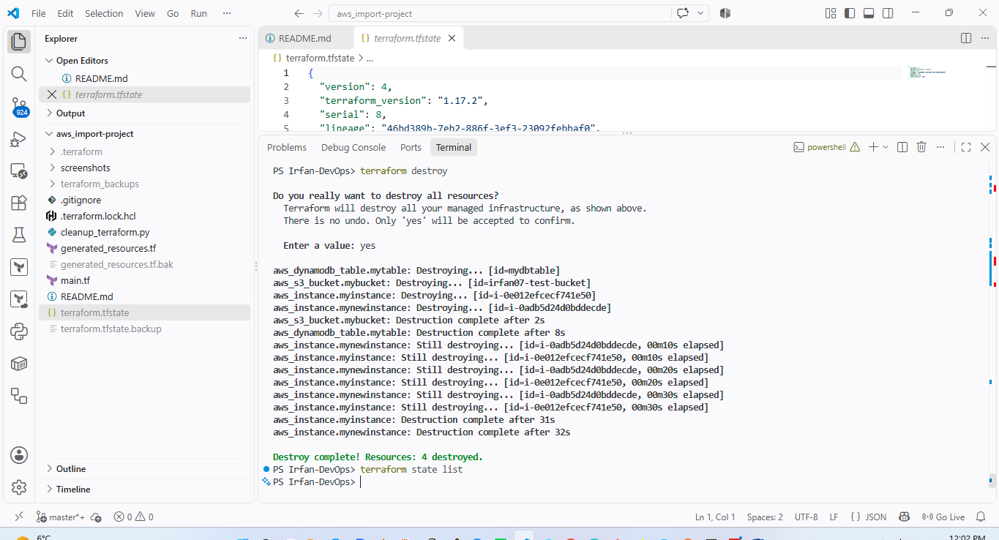
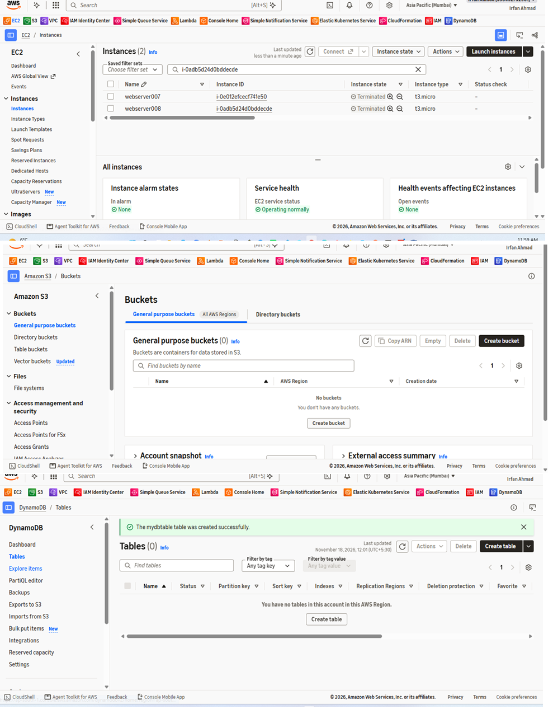

# Importing Existing AWS Infrastructure into Terraform

**Project by Irfan Ahmad | DevOps Engineer**

## Project Architecture


## 1. Project Overview

This project demonstrates how to import existing AWS infrastructure into Terraform and manage it using Infrastructure as Code (IaC).

Initially, I had one EC2 instance and one S3 bucket already available in my AWS account. Instead of recreating these resources through Terraform, I imported the existing resources into my Terraform project.

Later, I created another EC2 instance and a DynamoDB table directly through the AWS Management Console and imported them into the same Terraform project.

Finally, I verified that all four resources were managed by Terraform and performed a separate cleanup activity to destroy the resources.

### Project Objectives

- Import existing AWS resources into Terraform.
- Understand Terraform import blocks.
- Generate Terraform configurations automatically.
- Manage multiple AWS resources in a single Terraform project.
- Understand Terraform state management.
- Verify infrastructure consistency using `terraform plan`.
- Understand resource destruction and cleanup.

## 2. Technologies and Tools Used

| Technology | Purpose |
|---|---|
| AWS | Cloud infrastructure |
| Terraform | Infrastructure as Code |
| Amazon EC2 | Virtual machine instances |
| Amazon S3 | Object storage |
| Amazon DynamoDB | NoSQL database |
| AWS CLI | AWS authentication and access |
| Git | Version control |
| GitHub | Source code management |
| PowerShell | Command-line execution |

**AWS Region:** `ap-south-1` (Mumbai)    <!-- Replace with your preferred AWS Region -->

## 3. Initial AWS Infrastructure

Initially, the following resources were already available in my AWS account:

1. One EC2 instance.
2. One S3 bucket.

Instead of creating these resources again through Terraform, I imported the existing resources.

### Initial AWS Resources

| AWS Service | Terraform Resource Address |
|---|---|
| EC2 Instance | `aws_instance.myinstance` |
| S3 Bucket | `aws_s3_bucket.mybucket` |

### Initial EC2 and S3 Resources on AWS



## 4. Project Folder Structure

The project is organized as follows:

```text
Irfan-DevOps/
│
├── .gitignore
├── .terraform.lock.hcl
├── cleanup_terraform.py
├── generated_resources.tf
├── generated_resources.tf.bak
├── main.tf
├── README.md
├── terraform.tfstate
├── terraform.tfstate.backup
│
├── .terraform/
│
├── screenshots/
│   ├── AWS-Infrastructure-Import-with-Terraform.png
│   ├── dynamo-db-table-created-and-imported.png
│   ├── EC2-S3-initial-resource-import-1.png
│   ├── EC2-S3-on-AWS.png
│   ├── New-EC2-added-and-imported.png
│   ├── EC2-S3-Statelist-1.png
│   ├── final-statelist-validate-plan.png
│   ├── imported-resources-destroyed-and-statelist.png
│   └── EC2-S3-Dynamodb-destroyed-AWS.png
│
└── terraform_backups/
    └── generated_resources_backup_20261118_093513.tf
```

### Important Files

| File | Description |
|---|---|
| `main.tf` | Contains AWS provider configuration and Terraform import blocks. |
| `generated_resources.tf` | Contains generated configurations for imported AWS resources. |
| `cleanup_terraform.py` | Python script used to clean up Terraform-generated configuration. |
| `.terraform.lock.hcl` | Locks the selected Terraform provider version and checksums. |
| `.gitignore` | Specifies files and directories that should not be committed to GitHub. |
| `screenshots/` | Contains screenshots documenting the project workflow. |
| `terraform_backups/` | Contains backup copies of Terraform configuration files. |

**Note:** Terraform state files, the `.terraform/` directory, and local backup files should not be committed to a public GitHub repository. Review Terraform files for credentials and sensitive information before publishing.

## 5. Step 1 – Configure Terraform AWS Provider

First, I configured the AWS provider in `main.tf`.

```hcl
provider "aws" {
  region = "ap-south-1"            <!-- Replace with your preferred AWS Region -->
}
```

AWS credentials were configured separately using the AWS CLI.

Verify AWS authentication:

```powershell
aws sts get-caller-identity
```

Initialize Terraform:

```powershell
terraform init
```

## 6. Step 2 – Import the Initially Existing EC2 Instance

The first EC2 instance was already running in AWS.

Instead of creating another instance through Terraform, I imported the existing instance using a Terraform import block.

### Import Block

Added the following block in `main.tf`:

```hcl
import {
  to = aws_instance.myinstance
  id = "YOUR_EC2_INSTANCE_ID"        
```

Replace `YOUR_EC2_INSTANCE_ID` with the actual EC2 instance ID.

## 7. Step 3 – Import the Existing S3 Bucket

Next, I imported the existing S3 bucket into the same Terraform project.

### S3 Import Block

```hcl
import {
  to = aws_s3_bucket.mybucket
  id = "irfan07-test-bucket"       # Your preferred, globally unique bucket name
}
```

The S3 bucket name was used as its import ID.

### Generate Terraform Configuration

For the initial resources, I generated the configuration using:

```powershell
terraform plan -generate-config-out="generated_resources.tf"
```

Terraform generated the resource configurations based on the existing AWS resources.

I reviewed the generated configurations and retained them in `generated_resources.tf`.

### Initial EC2 and S3 Import Process

The screenshot below shows the initial EC2 and S3 import process.



### Verify Initial Terraform State

After importing the initial resources, I executed:

```powershell
terraform state list
```

The screenshot below shows the initial EC2 and S3 resources registered in Terraform state.


At this stage, Terraform was managing:

- One EC2 instance.
- One S3 bucket.

## 8. Step 4 – Add and Import a New EC2 Instance

After successfully importing the initial EC2 instance and S3 bucket, I created another EC2 instance directly through the AWS Management Console.

### New EC2 Instance Details

- Name: `webserver008`             <!-- Replace with your EC2 Instance name -->
- Instance type: `t3.micro`        <!-- Replace with your preferred instance type -->
- Availability Zone: `ap-south-1b` <!-- Replace with your preferred Availability Zone -->
- AWS Region: `ap-south-1`         <!-- Replace with your preferred AWS Region -->
- Terraform resource address: `aws_instance.mynewinstance`

### Import Block

I added another import block in `main.tf`:

```hcl
import {
  to = aws_instance.mynewinstance
  id = "enter instance-id"                        
}                                                   
```

I used a new Terraform resource address because every resource must have a unique address.

### Generate Configuration for the New EC2 Instance

Since `generated_resources.tf` already existed, I used a temporary output file:

```powershell
terraform plan -generate-config-out="temp_generated.tf"
```

Terraform generated the configuration for the newly created EC2 instance in `temp_generated.tf`.

### Review and Move Generated Configuration

After reviewing the generated configuration, I copied the complete resource block for:

```hcl
resource "aws_instance" "mynewinstance" {
  # Generated EC2 configuration
}
```

I moved this resource block into the existing `generated_resources.tf` file.

The temporary file was removed after confirming that the required configuration had been copied successfully.

### New EC2 Instance Successfully Imported



## 9. Step 5 – Add and Import a DynamoDB Table

After importing the second EC2 instance, I created a DynamoDB table directly through the AWS Management Console.

The objective was to import this newly created DynamoDB table into the same existing Terraform project.

### DynamoDB Table Details

- Table name: `mydbtable`
- Terraform resource address: `aws_dynamodb_table.mytable`

### DynamoDB Import Block

I added the following import block in `main.tf`:

```hcl
import {
  to = aws_dynamodb_table.mytable
  id = "mydbtable"                     <!-- Replace with your dynamodb_table_name -->
}
```

Here:

- `aws_dynamodb_table` is the Terraform resource type.
- `mytable` is the Terraform resource name.
- `mydbtable` is the existing DynamoDB table name in AWS.

### Generate DynamoDB Configuration

I generated the Terraform configuration using:

```powershell
terraform plan -generate-config-out="temp_generated.tf"
```

### Resolve Point-in-Time Recovery Configuration

During configuration generation, Terraform reported the following error:

```text
expected point_in_time_recovery.0.recovery_period_in_days
to be in the range (1 - 35), got 0
```

The generated configuration contained an invalid recovery period value.

After reviewing the actual DynamoDB table configuration, I removed the invalid `recovery_period_in_days = 0` argument and retained the appropriate setting:

```hcl
point_in_time_recovery {
  enabled = false
}
```

This setting should reflect the actual AWS table configuration.

### Review and Approve Terraform Plan

After correcting the configuration, I executed:

```powershell
terraform plan
```

Terraform displayed:

```text
Plan: 1 to import, 0 to add, 0 to change, 0 to destroy.
```

This confirmed that Terraform was going to import the existing DynamoDB table without creating, modifying, or destroying infrastructure.

I approved the import by entering:

```text
yes
```

The DynamoDB table was successfully imported.

### Move Generated Configuration

I reviewed the generated DynamoDB configuration in `temp_generated.tf` and moved the complete resource block into `generated_resources.tf`.

After confirming that the resource configuration had been copied successfully, I removed the temporary file.

### DynamoDB Table Successfully Imported



## 10. Step 6 – Final Terraform Resources

All imported resource configurations were maintained in:

`generated_resources.tf`

The project now manages the following AWS resources:

| No. | AWS Service | Terraform Resource Address |
|---|---|---|
| 1 | EC2 Instance | `aws_instance.myinstance` |
| 2 | S3 Bucket | `aws_s3_bucket.mybucket` |
| 3 | EC2 Instance | `aws_instance.mynewinstance` |
| 4 | DynamoDB Table | `aws_dynamodb_table.mytable` |

## 11. Step 7 – Format and Validate Terraform Configuration

After importing all resources and moving their generated configurations into `generated_resources.tf`, I formatted the Terraform files.

```powershell
terraform fmt
```

Next, I validated the configuration:

```powershell
terraform validate
```

Expected output:

```text
Success! The configuration is valid.
```

This confirmed that the Terraform configuration was syntactically valid.

## 12. Step 8 – Verify Imported Resources in Terraform State

To verify that all resources were successfully imported, I executed:

```powershell
terraform state list
```

The final output was:

```text
aws_dynamodb_table.mytable
aws_instance.myinstance
aws_instance.mynewinstance
aws_s3_bucket.mybucket
```

This confirmed that all four AWS resources were present in Terraform state.

### Inspect Individual Resources

To view the complete details of the new EC2 instance:

```powershell
terraform state show aws_instance.mynewinstance
```

To view the imported S3 bucket:

```powershell
terraform state show aws_s3_bucket.mybucket
```

To view the imported DynamoDB table:

```powershell
terraform state show aws_dynamodb_table.mytable
```

## 13. Step 9 – Final Terraform Plan and Infrastructure Verification

Finally, I executed:

```powershell
terraform plan
```

Terraform refreshed all four AWS resources and compared the actual AWS infrastructure against the Terraform configuration.

### Final Terraform Plan Result

```text
No changes. Your infrastructure matches the configuration.
```

This confirmed that all four imported resources were successfully managed by Terraform and that the configuration matched the actual AWS infrastructure.

No additional `terraform apply` was required because the final plan showed no infrastructure changes.

### Final Terraform State, Validation and Plan Verification



## 14. Important Terraform Concepts Learned

Through this hands-on project, I gained practical experience with:

1. Importing existing AWS resources into Terraform.
2. Using Terraform import blocks.
3. Generating Terraform configurations using `-generate-config-out`.
4. Understanding why Terraform requires a new output file during configuration generation.
5. Managing multiple AWS resources in a single Terraform project.
6. Understanding Terraform resource addresses.
7. Managing Terraform state using `terraform state list` and `terraform state show`.
8. Resolving configuration issues during resource import.
9. Formatting and validating Terraform configurations.
10. Verifying infrastructure consistency using `terraform plan`.

## 15. Best Practices Followed

- Reviewed generated Terraform configurations before using them.
- Used unique Terraform resource addresses for each imported resource.
- Kept generated resource configurations organized in `generated_resources.tf`.
- Used `temp_generated.tf` for generating configurations for newly added AWS resources.
- Moved reviewed resource blocks from the temporary file into the existing generated resource file.
- Validated Terraform configuration after modifications.
- Reviewed the Terraform plan before approving imports.
- Verified the final Terraform state.
- Avoided unnecessary changes to existing AWS infrastructure.
- Kept Terraform state files and sensitive credentials out of the public GitHub repository.

## 16. Optional Cleanup – Destroy Imported AWS Resources

After completing the import and verification process, I performed a separate cleanup activity to destroy the AWS resources.

This step demonstrates that Terraform can also manage the lifecycle of imported infrastructure, including its destruction.

**Important:** Destroying resources is a destructive operation. It can permanently delete infrastructure and data. Always verify the Terraform plan and confirm that the resources are safe to delete before proceeding.

### Terraform Cleanup and State Verification

The following screenshot documents the separate cleanup activity and Terraform state verification.



### AWS Resources Destroyed

The following screenshot shows the AWS Console after the EC2 instances, S3 bucket and DynamoDB table were destroyed.



**Note:** These cleanup screenshots represent a separate activity after the successful four-resource verification. They do not replace the earlier final Terraform plan showing that all four resources were successfully managed.

## 17. Final Project Outcome

| AWS Service | Imported Resources | Status |
|---|---:|---|
| Amazon EC2 | 2 | Successfully imported |
| Amazon S3 | 1 | Successfully imported |
| Amazon DynamoDB | 1 | Successfully imported |
| **Total** | **4** | **Successfully managed** |

**Final Terraform Result before cleanup:**

```text
No changes. Your infrastructure matches the configuration.
```

This project demonstrates a practical real-world Terraform workflow where existing AWS infrastructure was imported, new AWS resources were added over time, all resources were brought under Terraform management, and a separate cleanup activity was performed afterward.

## Author

**Irfan Ahmad**  
DevOps Engineer

- Project Repository: [AWS Terraform Resource Import Project](https://github.com/Irfan-devops1/terraform-aws-resource-import-project)
- GitHub Profile: [Irfan-devops1](https://github.com/Irfan-devops1)